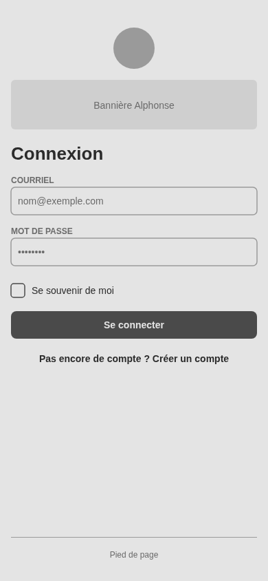
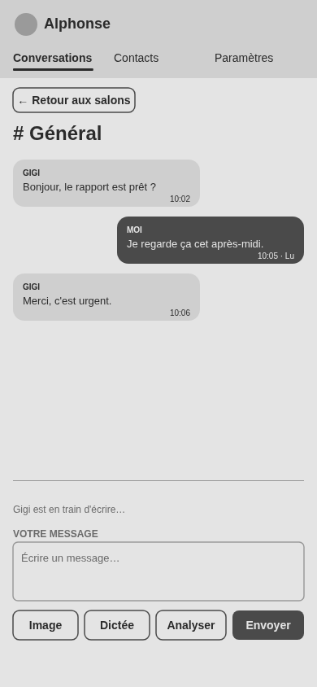
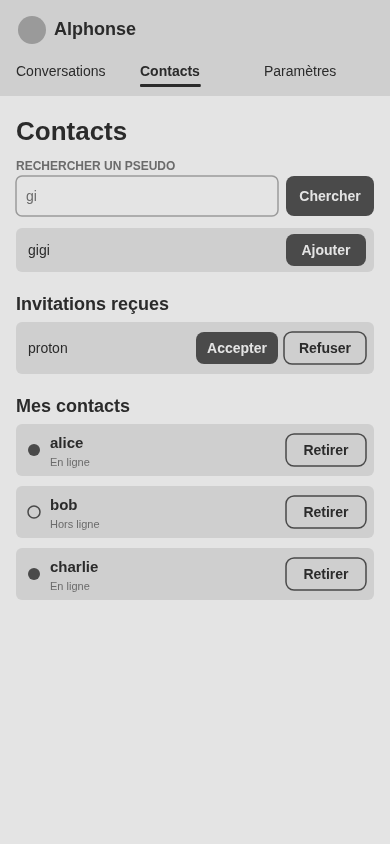
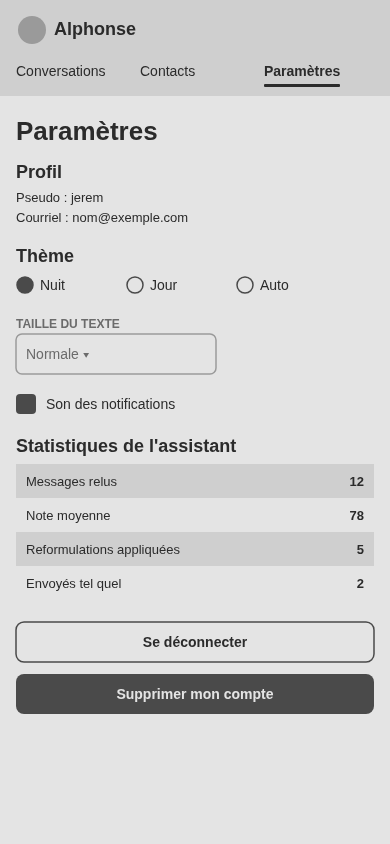
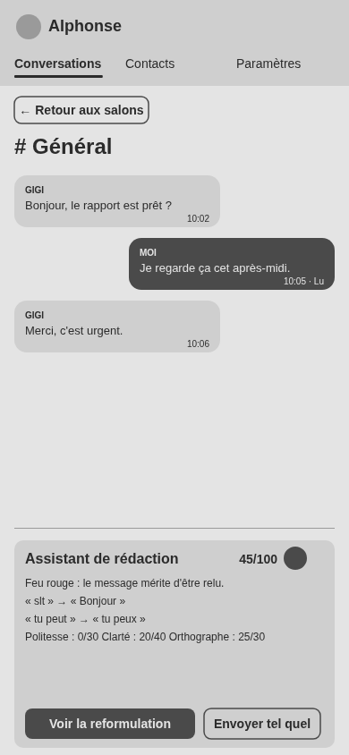
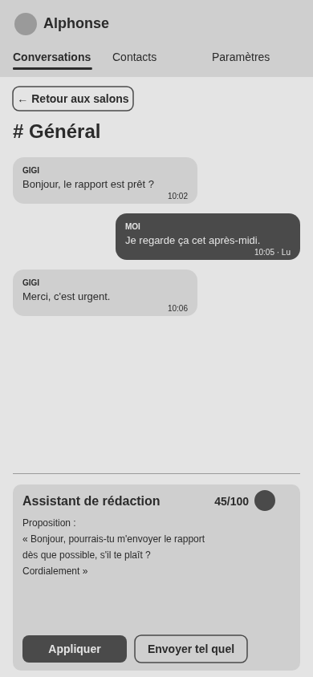
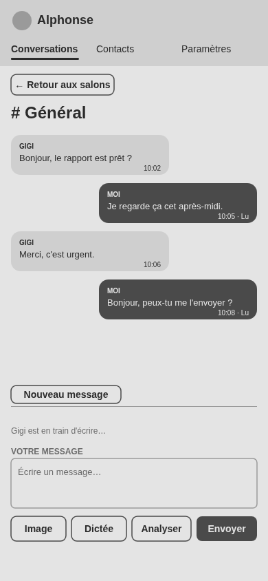

# Alphonse

Alphonse est une messagerie web professionnelle réservée aux étudiants et au personnel de l'UQAC. Sa particularité : un assistant de rédaction relit chaque message avant l'envoi, lui attribue une note sur 100 et propose une version corrigée et plus courtoise.

Projet fil-rouge du cours 8WEB101 — Technologies Web (UQAC, automne 2026).

**Site en ligne :** https://jerem-ctrl.github.io/alphonse/


# Équipe

| Membre | Compte GitHub |
|---|---|
| Olwen CRAVILLY--MITAINE | Cravilly-Olwen |
| Jérémy GIRARD | Jerem-ctrl |


# Fonctionnalités

## Comptes et authentification
- **Inscription** dans une fenêtre `<dialog>` : pseudo, adresse courriel UQAC et mot de passe (8 caractères au moins, dont une lettre et un chiffre).
- **Inscription réservée à l'UQAC** : seules les adresses `@uqac.ca` et `@etu.uqac.ca` sont acceptées, vérifiées par le navigateur puis par Supabase.
- **Connexion** par courriel et mot de passe, avec des messages d'erreur en français et l'option « Se souvenir de moi ».
- **Redirection automatique** : une personne déjà connectée arrive directement sur la messagerie ; une personne non connectée est renvoyée vers la page de connexion.
- **Déconnexion** et **suppression du compte** depuis les paramètres, après confirmation.

## Messagerie
- Création de salons et liste des salons, avec le nombre de messages non lus.
- Envoi et affichage des messages, horodatés, et réception en temps réel sur un autre appareil.
- Historique chargé par paquets de 50 messages : les plus anciens arrivent en remontant le fil.
- Messages regroupés par auteur lorsqu'ils se suivent de près.
- Suppression de ses propres messages, après confirmation.
- Brouillon conservé par salon, et dernier salon rouvert automatiquement.

## Fonctionnalités secondaires
- **Notification** visuelle et sonore : pastille sur le salon, compteur dans le titre de l'onglet, son (désactivable).
- **Partage d'images** : PNG, JPEG, WebP ou GIF, 2 Mo au plus.
- **Présence** : point « en ligne / hors ligne » à côté des pseudos.
- **« … est en train d'écrire »**.
- **Statuts « envoyé », « reçu » et « lu »** sous ses propres messages.

## Contacts
- Recherche des personnes inscrites par pseudo.
- Invitations : la personne ajoutée voit l'invitation et peut l'accepter ou la refuser.
- Liste de ses contacts, avec leur présence.

## Paramètres
- Profil (pseudo et courriel).
- Thème nuit, jour ou automatique (selon le système), et taille du texte.
- Son des notifications.
- Statistiques de l'assistant.

## Fonctionnalité supplémentaire : l'assistant de rédaction
Avant l'envoi, le bouton **Analyser** fait relire le message :
- le service **LanguageTool** repère les fautes d'orthographe, de grammaire et de typographie ;
- des règles locales évaluent la **politesse** (salutation, formule de politesse, termes familiers) et la **clarté** (longueur des phrases, majuscules, ponctuation) ;
- le message reçoit une **note sur 100** et un feu : vert à partir de 80, orange de 50 à 79, rouge en dessous ;
- les fautes sont surlignées dans le texte, avec la correction proposée, et une **reformulation** complète peut être appliquée en un clic ;
- un message noté sous 80 est retenu : la personne choisit entre corriger et « Envoyer tel quel ».

La **dictée vocale** permet aussi d'écrire un message à la voix, dans les navigateurs qui la proposent.


# Services Web utilisés

## LanguageTool
API publique de correction (https://languagetool.org), appelée avec `fetch` en `POST`. Le texte n'est envoyé à ce service tiers que lorsque la personne demande une analyse. Un appel qui dépasse 10 secondes est interrompu (`AbortController`), et les 30 dernières analyses sont gardées en mémoire pour ne pas renvoyer deux fois le même texte. L'étude de l'API, ses limites et nos tests sont détaillés dans [`docs/api-languagetool.md`](docs/api-languagetool.md).

## Supabase
- **Authentification** : les comptes (courriel et mot de passe haché) sont gérés par Supabase Auth ; aucun mot de passe n'est stocké dans nos tables.
- **Base de données** PostgreSQL : voir la section [Base de données](#base-de-données).
- **Temps réel** : nouveaux messages, suppressions, salons, lectures et présence arrivent sans recharger la page ; l'indicateur « en train d'écrire » passe par la diffusion (Broadcast), sans rien écrire en base.
- **Stockage** : le compartiment `images` reçoit les images partagées.


# Technologies

- **HTML5** sémantique et accessible.
- **CSS3** : variables, Flexbox, Grid, media queries, animations, thèmes.
- **Polices** DM Serif Display (titres) et Inter (texte), hébergées dans `assets/fonts/` sous licence SIL OFL : aucun appel à Google Fonts, donc aucune adresse IP de visiteur transmise à un tiers.
- **JavaScript** sans framework.
- **Supabase** (bibliothèque supabase-js 2.118.0, chargée depuis jsDelivr).
- **LanguageTool** pour la correction.
- **GitHub Pages** pour l'hébergement.


# Structure du projet

```
alphonse/
├── index.html                  Connexion et inscription
├── pages/
│   ├── conversation.html       Salons, messages et assistant
│   ├── contact.html            Recherche, invitations et contacts
│   └── parametre.html          Profil, préférences, statistiques, compte
├── assets/
│   ├── css/
│   │   ├── style.css           Charte graphique et styles communs : couleurs, polices, thèmes nuit et jour
│   │   ├── conversation.css    Mise en page de la messagerie et de l'assistant
│   │   └── contact.css         Mise en page des contacts
│   ├── fonts/                  DM Serif Display et Inter, avec leurs licences OFL
│   ├── img/                    Logo et bannières (nuit et jour), en PNG et en WebP
│   ├── sons/                   Son de notification (OGG et MP3)
│   └── js/
│       ├── local.js            Stockage du navigateur : préférences, session, brouillons, statistiques
│       ├── spclient.js         Création du client Supabase
│       ├── auth.js             Inscription, connexion, déconnexion, session
│       ├── data.js             Toutes les requêtes : salons, messages, contacts, images, temps réel
│       ├── presence.js         Présence en ligne / hors ligne
│       ├── ecriture.js         Indicateur « en train d'écrire »
│       ├── alphonse.js         Assistant de rédaction (LanguageTool et règles locales)
│       ├── notification.js     Pastilles, titre de l'onglet et son
│       ├── dictee.js           Dictée vocale
│       ├── theme.js            Thème et taille du texte
│       ├── connexion.js        Page de connexion et d'inscription
│       ├── conversation.js     Page des conversations
│       ├── contact.js          Page des contacts
│       └── parametre.js        Page des paramètres
└── docs/
    ├── README.md               Sommaire du dossier de conception
    ├── bdd/                    Schéma SQL et documentation de la base de données
    ├── charte/                 Charte graphique (couleurs, typographies, composants)
    ├── croquis/                Croquis des pages, dessinés à la main
    ├── maquette/               Maquette fil de fer, relecture Nielsen et prototype (exports Penpot)
    ├── api-languagetool.md     Étude de l'API LanguageTool
    ├── exemple-reponse.json    Exemple de réponse de LanguageTool
    ├── arborescence.jpeg
    ├── flux-utilisation.jpeg
    ├── planche-inspiration.png
    └── fiche-analyse.pdf
```

**Convention de nommage :**
- les fichiers repris du projet Webchat du cours gardent leur nom d'origine (`spclient.js`, `auth.js`, `data.js`), ainsi que leurs fonctions (`signIn`, `fetchMessages`, `sendMessage`…) ;
- nos propres fichiers, fonctions et variables sont nommés en français, en minuscules, avec des tirets pour les fichiers (`logo-alphonse-128.webp`) et le camelCase pour le JavaScript (`afficherMesContacts`) ;
- chaque page HTML a son script et, si besoin, sa feuille de style du même nom (`contact.html`, `contact.js`, `contact.css`).


# Architecture et ordre de chargement des scripts

Comme dans le projet Webchat, le code est organisé en couches. Chaque couche n'utilise que celles du dessous :

| Couche | Fichiers | Rôle |
|---|---|---|
| 1. Stockage local | `local.js` | Seul accès à `localStorage` et `sessionStorage` |
| 2. Client | `spclient.js` | Crée le client Supabase (avec l'adaptateur de session de `local.js`) |
| 3. Services | `auth.js`, `data.js` | Seuls fichiers qui interrogent Supabase ; renvoient `{ data, error }` |
| 4. Modules | `presence.js`, `ecriture.js`, `alphonse.js`, `notification.js`, `dictee.js`, `theme.js` | Objets qui calculent ou préviennent, sans jamais toucher au DOM |
| 5. Pages | `connexion.js`, `conversation.js`, `contact.js`, `parametre.js` | Seuls fichiers qui lisent et modifient la page |

Chaque page charge ses scripts dans cet ordre, par exemple pour les conversations :

1. `local.js`, sans `defer`, car `spclient.js` en a besoin ;
2. la bibliothèque supabase-js ;
3. `spclient.js`, `auth.js`, `data.js` ;
4. les modules dont la page a besoin ;
5. le script de la page, en dernier, puis `theme.js`.

Les scripts sont chargés avec `defer` : ils s'exécutent dans l'ordre, une fois le HTML lu.


# Notions du cours appliquées

## HTML : 52 types d'éléments
| Catégorie | Éléments |
|---|---|
| Document | `html`, `head`, `title`, `meta`, `link`, `script`, `body` |
| Structure sémantique | `header`, `nav`, `main`, `aside`, `section`, `footer` |
| Texte | `h1`, `h2`, `h3`, `p`, `span`, `strong`, `small`, `time`, `a` |
| Listes | `ul`, `li`, `dl`, `dt`, `dd` |
| Formulaires | `form`, `fieldset`, `legend`, `label`, `input`, `textarea`, `select`, `option`, `button` |
| Tableaux | `table`, `caption`, `thead`, `tbody`, `tfoot`, `tr`, `th`, `td` |
| Médias | `img`, `picture`, `source`, `audio` |
| Interactifs | `dialog`, `details`, `summary` |
| Générique | `div` |

Les éléments créés en JavaScript (`article`, `mark`, `del`, `ins`, `q`…) ne sont pas comptés.

Points d'accessibilité : textes alternatifs, `label` reliés à chaque champ, `aria-describedby` pour les aides et les erreurs, `role="status"` et `role="alert"` pour les messages, `aria-current`, `aria-pressed`, `aria-label` sur les boutons répétés, `lang="fr"`.

## CSS : 94 propriétés
| Notion | Application |
|---|---|
| Variables | Couleurs, espacements et filets de la charte dans `:root`, redéfinis pour le thème jour |
| Boîte | `box-sizing`, `margin`, `padding`, `border`, `border-radius`, `box-shadow` |
| Flexbox | Bulles de messages, en-têtes, cartes de contacts |
| Grid | Formulaire d'envoi, deux colonnes de la messagerie à partir de 768 px |
| Adaptabilité | Approche mobile d'abord, media queries, `clamp()`, unités `rem`, `vw` et `dvh`, `env(safe-area-inset-bottom)` |
| Typographie | `@font-face`, `font-display`, `hyphens`, `overflow-wrap`, `font-variant-numeric` |
| Sélecteurs | Pseudo-classes `:hover`, `:focus-visible`, `:disabled`, `:not()`, `:has()`, `:nth-child()`, `:empty` ; pseudo-éléments `::before`, `::after`, `::marker`, `::placeholder`, `::backdrop`, `::file-selector-button`, `::selection` |
| Animations | `transition`, `@keyframes` (pastille, indicateur d'écriture), désactivées avec `prefers-reduced-motion` |
| Thèmes | `color-scheme`, `prefers-color-scheme`, `color-mix()` |

## JavaScript
| Notion | Application |
|---|---|
| DOM | `getElementById`, `createElement`, `textContent`, `replaceChildren`, `dataset`, `classList` |
| Événements | `submit`, `input`, `click`, `keydown`, `change` ; délégation avec `closest()` |
| Asynchrone | `async` / `await`, `Promise.all`, `fetch`, `AbortController`, `try` / `catch` / `finally` |
| Minuteurs | `setTimeout` (anti-rebond de la recherche et de l'analyse), `setInterval` (présence) |
| Structures | Objets, tableaux et leurs méthodes (`map`, `filter`, `find`, `sort`), `Map`, une classe (`class Defaut`), `switch` |
| Persistance | `localStorage`, `sessionStorage`, `JSON.stringify` et `JSON.parse` |
| Services Web | Supabase (base de données, temps réel, stockage) et LanguageTool |


# Charte graphique et principes de conception

## Charte graphique
- **Couleurs** reprises du logo, avec un thème nuit (par défaut) et un thème jour ; les contrastes respectent le niveau AA (4,5:1 au moins pour le texte).
- **Typographies** : DM Serif Display pour les titres, Inter pour le texte.
- **Formes** : bulles de messages arrondies, avec un coin pointu du côté de l'auteur ; filets fins pour séparer les zones.
- Le détail se trouve dans [`docs/charte/`](docs/charte/apercu.png).

## Heuristiques de Nielsen
| Heuristique | Application |
|---|---|
| Visibilité de l'état du système | Statuts envoyé, reçu et lu ; « en train d'écrire » ; présence en ligne ; pastilles des messages non lus ; « Analyse en cours… » |
| Correspondance avec le monde réel | Vocabulaire courant (salon, contact, brouillon) et feu de circulation pour la note du message |
| Contrôle et liberté de l'utilisateur | « Envoyer tel quel », retour à la liste des salons, bouton Annuler dans chaque boîte de dialogue |
| Cohérence et standards | Même en-tête sur toutes les pages ; le logo ramène aux conversations |
| Prévention des erreurs | Envoi retenu sous 80/100 ; confirmation avant toute suppression ; règles affichées sous les champs |
| Reconnaissance plutôt que rappel | Brouillon et dernier salon conservés ; correction affichée à côté de la faute |
| Esthétique et minimalisme | Un seul panneau à la fois sur téléphone |
| Aide à reconnaître et corriger les erreurs | Fautes surlignées avec la correction proposée ; messages d'erreur en clair, à côté du champ concerné |

## Principes de la Gestalt
| Principe | Application |
|---|---|
| Proximité | Les messages d'un même auteur envoyés à moins de 5 minutes d'intervalle se collent, et le pseudo n'est pas répété |
| Similarité | Ses propres messages en bleu à droite, ceux des autres en gris à gauche |
| Figure-fond | Fond assombri derrière les boîtes de dialogue |
| Région commune | Chaque contact et chaque bloc de l'assistant dans un cadre |

# Conception

La conception a suivi la démarche du cours : fiche d'analyse, arborescence et flux d'utilisation, croquis à la main, puis maquette fil de fer et prototype interactif réalisés avec Penpot.

**Prototype Penpot (lien public) :** [ouvrir le prototype](https://design.penpot.app/?screen=viewer&file-id=d3aee43a-8d21-8092-8008-ea812d7c6151&page-id=c5491450-457d-8059-8008-ea81583466aa&section=interactions&frame-id=c5491450-457d-8059-8008-ea951477de1e&index=0&share-id=0f08110d-f016-450e-a214-4580bb9b9061)

## Maquette fil de fer
Les quatre pages du site, au format téléphone, puisque la mise en page a été pensée d'abord pour le mobile.

| Connexion | Conversations | Contacts | Paramètres |
|---|---|---|---|
|  |  |  |  |

## Prototype interactif : l'assistant de rédaction
Le prototype suit le parcours de la fonctionnalité supplémentaire : rédaction, analyse, reformulation, puis envoi.

| 1. Rédaction | 2. Analyse | 3. Reformulation | 4. Envoi |
|---|---|---|---|
|  |  |  |  |

Les autres documents de conception sont regroupés dans le dossier [`docs`](docs/README.md).


# Persistance des données

| Donnée | Où | Pourquoi |
|---|---|---|
| Comptes, salons, messages, contacts, lectures | Supabase (PostgreSQL) | Partagées entre personnes et appareils |
| Images | Supabase Storage | Fichiers trop lourds pour le navigateur, partagés |
| Session de connexion | `localStorage` avec « Se souvenir de moi », sinon `sessionStorage` | Survit à la fermeture du navigateur uniquement si la personne le demande |
| Thème, taille du texte, son | `localStorage` | Préférences propres à cet appareil |
| Statistiques de l'assistant | `localStorage` | Personnelles, sans intérêt pour les autres |
| Brouillons, dernier salon, messages non lus | `sessionStorage` | Disparaissent avec l'onglet : un brouillon peut être privé |

Chaque valeur est enregistrée avec `JSON.stringify`, relue avec `JSON.parse`, puis vérifiée (type, nombre entier positif…), car le stockage peut être modifié depuis la console. Chaque accès est placé dans un `try` / `catch` : en navigation privée, le stockage peut être refusé sans bloquer la page.

**Pourquoi pas de cookies ?** Un cookie est envoyé au serveur avec chaque requête. Or GitHub Pages ne sert que des fichiers statiques et ne lit aucun cookie : ce serait du trafic inutile, une capacité limitée à 4 Ko, et une donnée de plus à déclarer au titre de la Loi 25.

**Pourquoi pas IndexedDB ?** IndexedDB sert à stocker beaucoup de données structurées ou des fichiers dans le navigateur. Nos données locales sont quelques petites valeurs, pour lesquelles `localStorage` suffit ; les messages et les images, eux, doivent être partagés et vont donc dans Supabase.


# Sécurité

| Protection | Mise en œuvre | Test réalisé | Résultat |
|---|---|---|---|
| Clé publique uniquement | Seule la clé « publishable » de Supabase figure dans `spclient.js` | Recherche de la clé secrète dans le dépôt | Absente |
| Row Level Security | Activée sur toutes les tables : seuls les comptes connectés lisent, chacun n'écrit et ne supprime que ses propres lignes | Supprimer depuis la console le message d'une autre personne | Aucune ligne supprimée, le message reste |
| Contacts privés | Une ligne de contact n'est visible que par les deux personnes concernées | Lire toute la table `contacts` depuis la console | Seules ses propres lignes reviennent |
| Visiteurs non connectés | Aucun droit sur les tables ; les pages protégées renvoient vers la connexion | Ouvrir `pages/conversation.html` sans session | Retour à la page de connexion |
| Profil créé côté serveur | Le trigger `creation_profil` crée le profil à l'inscription : le pseudo ne peut pas être falsifié par le navigateur | Inscription d'un nouveau compte | Profil créé avec le bon pseudo |
| Adresses UQAC uniquement | La fonction `filtre_email` refuse toute autre adresse, même si le formulaire est contourné | Inscription avec une adresse Gmail, formulaire contourné | Refusée par Supabase |
| Injection de code (XSS) | Pseudos et messages affichés avec `textContent`, jamais comme du HTML | Envoi du message `` | Affiché comme du texte, aucun script exécuté |
| Politique de sécurité du contenu (CSP) | Balise `<meta http-equiv="Content-Security-Policy">` sur chaque page : scripts du site et de jsDelivr seulement, connexions limitées à Supabase et LanguageTool, `object-src 'none'` | Exécution d'un script en ligne depuis la page | Bloqué par le navigateur |
| Intégrité de la bibliothèque | supabase-js figée en version 2.118.0, avec un attribut `integrity` (SRI) | Chargement de la page | Aucune erreur d'intégrité |
| Images | PNG, JPEG, WebP ou GIF (pas de SVG, qui peut contenir du script), 2 Mo au plus, extension déduite du type réel, fichier décodé avant l'envoi ; chacun ne dépose et ne supprime que dans son propre dossier | Envoi d'un fichier texte renommé en `.png` | Refusé |
| Suppression du compte | La fonction `supprimer_mon_compte()` ne supprime que le compte connecté ; la cascade emporte profil, messages, lectures, contacts et images | Suppression d'un compte de test | Compte et données supprimés |
| Validation en deux couches | Les règles du formulaire (`required`, `pattern`, `minlength`) servent au confort ; les vraies vérifications sont faites par Supabase | Envoi d'un formulaire modifié dans l'inspecteur | Refusé par Supabase |

GitHub Pages ne permet pas d'envoyer d'en-têtes HTTP : la CSP passe donc par une balise `<meta>`, qui ne couvre pas `frame-ancestors` (protection contre l'affichage du site dans un cadre).


# Base de données

Cinq tables dans Supabase, toutes protégées par la Row Level Security :

| Table | Contenu |
|---|---|
| `utilisateurs` | Profil public : pseudo et date de dernière activité (pour la présence) |
| `salons` | Nom du salon, auteur et date de création |
| `messages` | Texte, image éventuelle, auteur, salon et date |
| `lectures` | Dernier message lu par chaque personne dans chaque salon (statut « lu ») |
| `contacts` | Invitations et contacts : qui a ajouté qui |

S'y ajoutent le compartiment de stockage `images`, le trigger `creation_profil`, et les fonctions `filtre_email` et `supprimer_mon_compte`. Le schéma complet est dans [`docs/bdd/schema.sql`](docs/bdd/schema.sql), et sa documentation, table par table, dans [`docs/bdd/base-de-donnees.md`](docs/bdd/base-de-donnees.md).


# Ajouts hors cours

Notions que nous avons utilisées sans qu'elles soient présentées en cours :
- **Supabase Storage** et **Broadcast** (temps réel sans écriture en base) ;
- **Row Level Security** écrite nous-mêmes, avec des fonctions et un trigger PostgreSQL ;
- **Politique de sécurité du contenu (CSP)** et **intégrité des sous-ressources (SRI)** ;
- **API Web Speech** pour la dictée vocale, avec détection de sa disponibilité ;
- **`AbortController`** pour limiter la durée d'un appel à LanguageTool ;
- **`createImageBitmap`** pour vérifier qu'un fichier est une vraie image et lire ses dimensions ;
- **`<picture>`, `srcset` et `sizes`** avec des images WebP, et `fetchpriority` sur la bannière ;
- **`<dialog>`** et `showModal()` pour les confirmations, à la place de `confirm()` ;
- **CSS récent** : `:has()`, `color-mix()`, unité `dvh`, `prefers-reduced-motion`.


# Installation

Le site fonctionne directement en ligne. Pour le faire tourner sur un autre projet Supabase :

1. Créer un projet sur [supabase.com](https://supabase.com).
2. Dans **SQL Editor**, exécuter le contenu de `docs/bdd/schema.sql`.
3. Dans **Authentication > Hooks**, activer le hook **Before User Created** avec la fonction `public.filtre_email`.
4. Dans **Authentication > Sign In / Providers > Email**, désactiver **Confirm email**.
5. Dans `assets/js/spclient.js`, remplacer `SUPABASE_URL` et `SUPABASE_PUBLISHABLE_KEY` par ceux du nouveau projet (**Project Settings > API Keys**).
6. Ouvrir `index.html` dans un navigateur, ou publier le dépôt avec GitHub Pages.


# Limites et pistes d'amélioration

| Limite | Piste d'amélioration |
|---|---|
| Tous les salons sont visibles par tous les comptes connectés : il n'existe ni salon privé ni conversation à deux | Ajouter des membres aux salons, avec une Row Level Security par membre |
| L'API publique de LanguageTool limite le nombre de requêtes par minute, et le texte analysé est envoyé à un service tiers | Héberger notre propre serveur LanguageTool |
| Les règles de politesse et de clarté sont simples et ne visent que le français | Enrichir les règles, ou les rendre configurables |
| La dictée vocale ne fonctionne que dans les navigateurs qui proposent l'API Web Speech (Chrome, Edge, Safari) | Masquer le bouton ailleurs (déjà fait) ou passer par un service de transcription |
| La présence est approximative : une personne est « en ligne » si elle a été active dans les 2 dernières minutes | Utiliser la présence de Supabase Realtime |
| Aucune notification lorsque l'onglet est fermé | Notifications système avec un service worker |
| Pas de réinitialisation du mot de passe | Utiliser l'envoi de courriel de Supabase Auth |
| La CSP en `<meta>` ne couvre pas `frame-ancestors` | Héberger le site sur un service qui permet les en-têtes HTTP |
| Les statistiques de l'assistant sont propres à chaque navigateur | Les enregistrer dans Supabase |


# Répartition de notre travail

## Olwen CRAVILLY--MITAINE
- Premières pages HTML (paramètres, conversations) et base du CSS (variables de couleurs).
- Configuration de Supabase, fonctions d'authentification et inscription en pop-up.
- Réorganisation de l'arborescence et déplacement des pages dans `pages/`.
- Première version des pages Paramètres, Contacts et Conversations, et style de la page de connexion.
- Documentation des tables de la base de données.
- Intégration de la présence, du thème, de l'indicateur d'écriture, des notifications, du partage d'images et de la suppression du compte.
- Relecture et réécriture des commentaires du HTML, du CSS et de plusieurs fichiers JavaScript.

## Jérémy GIRARD
- Conception : fiche d'analyse, arborescence, flux d'utilisation, croquis, charte graphique, maquette et prototype Penpot, planning.
- Étude de l'API LanguageTool et assistant de rédaction (`alphonse.js`), avec son interface et son style.
- Couche de données (`data.js`) et page des conversations (`conversation.js`) : temps réel, historique, statuts envoyé, reçu et lu.
- Invitations de contacts, préférences, statistiques et dictée vocale.
- Sécurité : Row Level Security, CSP, SRI, vérification des images.
- Images optimisées en WebP, tests et rédaction du README.


# Sources

- Projet **Webchat** de Damien Brun, présenté dans le cours (licence MIT). Nous nous sommes appuyés sur son organisation en couches et sur ses fichiers `spclient.js`, `auth.js` et `data.js`, que nous avons ensuite modifiés et largement complétés : erreurs affichées dans la page, pseudo enregistré par un trigger, inscription en pop-up, filtre des adresses UQAC, contacts, images, présence, statuts de lecture.
- Cours et TD du cours 8WEB101.
- [Documentation de Supabase](https://supabase.com/docs).
- [Documentation de l'API LanguageTool](https://dev.languagetool.org/public-http-api).
- [MDN Web Docs](https://developer.mozilla.org/fr/) pour le HTML, le CSS et le JavaScript.
- Polices [DM Serif Display](https://fonts.google.com/specimen/DM+Serif+Display) et [Inter](https://rsms.me/inter/), licence SIL OFL.


# Usage de l'IA

Conformément au plan de cours, nous indiquons avoir utilisé un agent conversationnel (Claude, d'Anthropic) comme outil d'aide au développement : explication de notions, aide à l'écriture et à la correction d'une partie du code JavaScript et CSS, relecture du français de la documentation. Tout le code a été relu, testé et compris par l'équipe, et chaque membre peut l'expliquer. La conception, les choix fonctionnels et les tests sont les nôtres.
